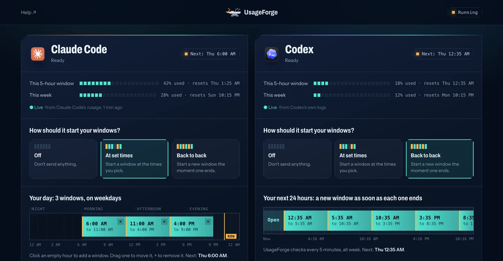

# UsageForge

**Your AI usage window, on your schedule.** An [Aurora Forge Lab](https://auroraforgelab.com/) product.

On the $20 Claude Pro / ChatGPT Plus plans, the 5-hour usage window starts with your first message.
UsageForge sends that first message for you, so a fresh window is already running when you sit down to work.

One bash script. No daemon, no stored credentials. It needs `bash` and `jq`; macOS 15+ ships `jq`, otherwise run `brew install jq` or `apt install jq`.
It uses `launchd` on macOS and `cron` on Linux. Windows isn't supported. WSL may work through cron, but it hasn't been tested.

**Product page:** https://kenny2077.github.io/UsageForge/



## Install

```bash
brew install kenny2077/tap/usageforge
usageforge ui        # pick your times in the control panel
usageforge doctor    # checks your setup and tells you what to fix
```

Without Homebrew:

```bash
git clone https://github.com/kenny2077/UsageForge && cd UsageForge
ln -s "$PWD/usageforge" ~/.local/bin/usageforge   # any directory on your PATH
```

You need `claude` (Claude Code) and/or `codex` installed and logged in. If the ChatGPT desktop app is installed, UsageForge uses the Codex CLI bundled inside it. Otherwise install it with `npm i -g @openai/codex`.
UsageForge pings whichever of the two it finds.

## Control panel

```bash
usageforge ui        # opens http://127.0.0.1:4517 in your browser (needs python3)
```

The terminal shows a small pixel black hole and the same setup check as `usageforge doctor`. At the top of the panel a black hole drawn in dots turns while the background check runs and holds still when it's off. The first time the panel opens, a short guide points out each part; **Guide** in the header replays it.

The panel has one section each for Claude Code and Codex. In each you can:
- pick a mode: **Off**, **At set times** or **Back to back**
- add ping times and choose the weekdays they run on, with a 24-hour preview of the windows they open

Below them, **Sleep and wake** (macOS). Each section also shows the 5-hour and weekly meters. Changes save automatically, and the background check turns itself on or off to match.
The panel only listens on 127.0.0.1, and every request must carry a random token that's created each time the panel starts.

## Sleep and wake (macOS)

- **Wake for set times** (on by default): a sleeping Mac wakes a minute after each set time (and when a Back to back window ends), so the window still starts. macOS has to allow it once: click **Allow** in the panel or run `usageforge wake allow`, which asks for your password and adds a rule to `/etc/sudoers.d/usageforge` that lets UsageForge run only `pmset schedule wake` and `pmset schedule cancel wake`. UsageForge keeps the Mac's wake schedule in step with your times. Turn it off and a sleeping Mac skips them.
- **Sleep when work is done** (off by default): between the hours you set, the Mac stays awake while Claude Code or Codex is working (its session log changed in the last 10 minutes), then sleeps once they've finished and nobody has touched it for 10 minutes. It stays up when a set time is less than 15 minutes away.

```bash
usageforge wake allow | on | off
usageforge sleep 23:30 08:00 | off
```

To remove the wake permission: `sudo rm /etc/sudoers.d/usageforge`. Closing the lid still sleeps the Mac, as always.

## Notifications

UsageForge sends a notification only when something goes wrong (offline, signed out, or a usage limit reached), at most once every 6 hours for each kind of problem. `usageforge notify-test` sends a test one.

## Modes from the terminal

`schedule` and `watch` set the mode for every installed tool (or only `UF_TOOLS="claude"`) and turn on the background check.

**1. Schedule: ping at fixed times you choose.**
```bash
usageforge schedule 06:00            # window runs 6–11, so your 9am session gets a reset at 11
usageforge schedule 06:00 11:00 16:00
```

**2. Watch: start the next window as soon as the last one resets.**
```bash
usageforge watch     # checks every 5 min; it only sends a message after a window ends
```

```bash
usageforge ping            # ping now (or: usageforge ping codex)
usageforge status          # each tool's mode and reset time, and the recent log (--json for scripts)
usageforge start | stop    # turn the background check on / off (settings stay in ~/.local/state/usageforge)
```

Settings live in `~/.local/state/usageforge/config.json`. For each tool it stores `mode`, `times`, `days` (0 = Sunday), `prompt` and `model`.
There's one background check, run every 5 minutes. It re-reads the settings each time, so changes take effect without reinstalling.
`start` copies the script into the state directory and runs it from there. macOS doesn't let launchd jobs read `~/Desktop` or `~/Documents`, and the copy also keeps working if you move or delete the repo.

## How it works

- **Ping.** The message is a plain greeting for the time of day ("Good morning", "Good afternoon" or "Good evening").
  Claude: `claude -p "Good morning" --model haiku --tools "" --safe-mode`, run from an empty directory with user settings off.
  That means no hooks, plugins, MCP or CLAUDE.md get loaded, so the ping uses very little quota.
  Codex: `codex exec --sandbox read-only --ignore-user-config -c model_reasoning_effort=low "Good morning"`.
  `--ignore-user-config` skips your MCP servers; it's added only on Codex versions that support it.
- **Reset detection (watch mode). It spends no quota and reads no tokens.**
  - Codex: UsageForge asks the Codex CLI itself for the account's live limits (`codex app-server`, `account/rateLimits/read`, the same call the Codex app makes). It sends no message and costs no quota, and it follows account switches.
    If that fails, it falls back to the limits Codex writes to `~/.codex/sessions/**/rollout-*.jsonl`. Either way it also sees windows you started yourself.
  - Claude: UsageForge runs Claude Code's own `/usage` command (`claude -p /usage`). It runs locally, sends no message and costs no quota.
    That gives the live 5-hour and weekly percentages and the exact reset times. The panel and menu bar ask at most every 5 minutes, the background check every 15, and a ping refreshes it.
- **When a ping fails:**
  - **Rate-limited** (5-hour or weekly cap): UsageForge waits until the reset time the server reports. For Codex it reads the weekly figure from the logs, so it doesn't send pings that can't succeed.
  - **Anything else** (still offline after a wake-up, logged out): it retries 3 times, one minute apart, then backs off for 15 minutes.
  - **Hung ping:** each one is killed after 2 minutes.
- Job pings wait a random 0–2 minutes (`UF_JITTER`, in seconds) so they don't land on the same second every day.
- Only one job run happens at a time, enforced with a lock. The log is trimmed to its last 1000 lines once it passes 2000.
- Logs go to `~/.local/state/usageforge/log`, which only your user can read.

## Caveats

- **A sleeping laptop can't send anything.** launchd runs a missed job as soon as the Mac wakes.
  **Wake for set times** (above) wakes it for each one.
  Linux cron skips jobs missed during sleep. Watch mode catches up on its next 5-minute check.
  cron uses the system time zone, which is often UTC on servers.
- **`claude -p` billing may change.** If Anthropic starts billing it separately (announced, then paused, in 2026), a `claude -p` ping might stop opening the interactive window. See `docs/research.md`.
- **Terms of service: your call.** UsageForge only runs the official `claude` and `codex` CLIs, unmodified and signed in as you. It never reads, copies or sends your credentials, calls no private endpoints, and never rotates accounts. Still, Anthropic's Consumer Terms bar access "through automated or non-human means, whether through a bot, script, or otherwise" unless Anthropic explicitly permits it, and OpenAI's terms bar programmatically extracting Output. A scheduled ping is automated use, and neither company has said whether it is allowed. The usage reads are rare (every 5–15 minutes) and send no messages. Use it at your own risk.
- Each ping uses a small amount of your weekly (7-day) quota. Watch mode sends about 4–5 pings a day.
- This moves *when* your window starts. It doesn't give you more usage.

## Uninstall

```bash
usageforge stop && rm -rf ~/.local/state/usageforge
```

## Test

`./test.sh` uses fake `claude`/`codex` binaries. It spends no quota and installs nothing.
It covers watch-mode ticks, rejected pings, retry and backoff, the Codex weekly cap, and escaping in the generated plist.

## Prior art

[CCAutoRenew](https://github.com/aniketkarne/CCAutoRenew), [cwarm](https://pypi.org/project/cwarm/) and [claude-warmup](https://github.com/vdsmon/claude-warmup) are all Claude-only. `docs/research.md` compares them.

## Upgrading from LimitKiller

The project was renamed. Run `limitkiller stop` first, then install `usageforge` and pick a mode again.

## License

MIT. Not affiliated with Anthropic or OpenAI.
